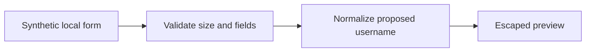

# IAM request preview: security review and remediation

## Scope and provenance

This case documents the review of the public DirBridge prototype and changes made on 2026-10-26. The starting point is commit `094e5a868baa8fd20bee2cc3ee7ff8e9042224c4`. It contains one Flask form handler and no working directory connector. Findings are based on source inspection; this is not a penetration test of a deployed service.

## Risk and priority

The handler derived a password from personal attributes and returned it in HTML. If reused for real identities, that design would make credentials predictable and expose them to the browser. The new lab removes password handling altogether. A production identity workflow should delegate credential enrollment to an approved identity platform.

User-controlled form values were inserted into an HTML response using string interpolation. An HTML payload could become active markup. The new implementation validates names and IDs, uses Jinja HTML templates, and rejects invalid input without reflecting it. Escaping remains necessary even with validation.

These priorities follow the potential identity and browser impact, without assigning an unsupported CVSS score or suggesting that the prototype is a production incident.

## Boundaries and decisions

No persistence, outbound call, directory write, password, or background worker is present. Employee ID is displayed only in the local response. Avoid real personal data; `no-store` is an additional browser caching control, not a data governance guarantee. Host checks and response headers do not provide authentication or network isolation.

## Verification

Run `python -m unittest discover -s tests -v`. Tests cover valid previews, absent fields, rejected script markup, quote escaping, accented names, unsupported normalization, field lengths, request size, untrusted host headers and response headers. Tests exercise Flask's test client rather than a live browser or directory.

## Production design still required

| Requirement | Intended control | Validation still needed |
|---|---|---|
| Request authenticity | SSO, authorization and approved request source | Denied requests and cross-role tests |
| State-changing workflow | Approval, CSRF protection where applicable, idempotency | Replay and duplicate request tests |
| Least privilege | Scoped identity connector with explicit allowed actions | Negative permission tests in isolated tenant |
| Traceability | Minimal structured events with actor, decision and correlation ID | Access, retention and tamper resistance checks |
| Resilience | Timeouts, controlled retries and rollback of partial changes | Fault injection and recovery exercise |
| Identity lifecycle | Joiner/mover/leaver policy and periodic access review | End-to-end lifecycle evidence |

This preview performs no state-changing operation; it does not implement these controls. It is not safe to expose as a provisioning service by merely adding a directory call.

## References

- [Flask security considerations](https://flask.palletsprojects.com/en/stable/web-security/)
- [Flask 3.1.3 package](https://pypi.org/project/Flask/3.1.3/)
